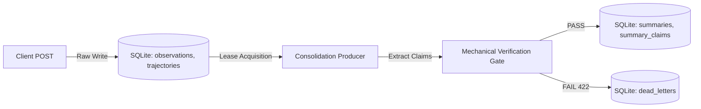

# Consolidation Architecture & Reference

> **Context & Scope.** This document defines the derived consolidation architecture for Neuralbrain.
> It details how background consolidation extracts actionable knowledge without corrupting raw records,
> examines common failure modes of LLM summarisation pipelines in memory systems, compares Prompt A vs Prompt B contracts,
> details the reasoning model token budget trap, and specifies invariants for derived rows.
>
> Master constitution: [CLAUDE.md](../CLAUDE.md). Contract schema: [docs/CONTRACTS.md](CONTRACTS.md). Verification gate: `src/consolidation/gate.ts`.

---

## 1. Design Philosophy: Whoever Is in the Room Does the Work

Summarisation is where many memory systems break, but having summaries is not the mistake. The usual design failures are:
1. It runs **on the ingest path**, so a hallucination or parse failure corrupts or drops the record itself.
2. It is **load-bearing for capacity** — consolidation exists to relieve a hard per-session cap. When consolidation is disabled because it hallucinates, the cap is hit and the store stops accepting data.
3. It requires a **server-managed API key**. With no key configured, consolidation breaks — while the host agent, already in the conversation loop with a strong model, sits idle.

Neuralbrain enforces **Rule 6**: *Derived records are additive, attributed, and disposable.*

- **Consolidation is an asynchronous read-side operation**, completely decoupled from ingest.
- It writes new rows into `summaries` and `summary_claims`, citing sources in `summary_sources`.
- Raw observations and trajectories are immutable once committed.
- Drop every summary row, and the brain remains 100% functional; you have lost only an index convenience, never source data.

---

## 2. The Three Producers

Consolidation can be performed by any of three producers. None of them is strictly required:

| Producer | Mechanism | Key Advantage |
|---|---|---|
| **Host Agent** *(Default)* | Agent pulls candidates via `brain_consolidate_candidates` and posts summaries via `brain_submit_summary` over MCP. | Zero API keys, zero cloud costs, zero local model VRAM. Claude Code, Claude Desktop, or Antigravity already holds full context and runs frontier intelligence. |
| **Local LLM** *(Opt-in)* | Local worker calls an OpenAI-compatible endpoint (LM Studio / Ollama). | Fully autonomous, unattended consolidation with complete data privacy. Requires a non-reasoning instruct model (e.g., `qwen3.5-9b`). |
| **Cloud Model** *(Opt-in)* | Worker calls configured cloud provider (`BRAIN_VENDOR=openai\|google\|anthropic`). | Offloads local CPU/GPU for unattended scheduled batch processing. |

---

## 3. Why Local Models Fail Under Typical Compression Prompts

Local models (e.g. Qwen on LM Studio) are often blamed for unusable memory output. Inspecting a typical memory-compression prompt shows the task is usually impossible as specified:

### 1. The Task Demands Creative Invention
A typical compression prompt demands around 8 XML fields per tool observation, including:
- `<narrative>`: *"2-3 sentence summary of what happened and why it matters"*
- `<importance>`: A calibrated integer on a 1–10 scale.

"Why it matters" is composition, not extraction. When an agent reads a file, nothing in the log states why it matters. Small models cannot calibrate numeric importance scales, causing them to default to a constant.
> **What it looks like in practice**: a model-assigned `strength` or `importance` field that holds the same mid-scale value on every record. That is not a measurement; it is a model shrugging once per record.

### 2. Truncated Ingest Overwrite
Compression runs synchronously on capture. Tool input and output are truncated (often to a few thousand characters) before being handed to the LLM, and the LLM's summary replaces the raw text. Once a hallucination occurs, the raw ground truth is gone for good.

### 3. The Quality Gate Measures Shape, Not Truth
A common pattern is a quality score that awards points for schema shape and length, for example:
- Facts non-empty: +25
- $\ge 3$ facts: +10
- Narrative $\ge 20$ chars: +20
- Title within length bounds: +15
- Concepts non-empty: +15
- Importance within 1–10: +10

Under a score like this, a model inventing five fictional facts with a 60-character narrative scores **100/100**. The dashboard reports near-perfect quality while the data is corrupted.

### 4. Compounded Semantic Merging
Many systems then summarise the summaries. Hallucinated prose becomes input to second-order fact extraction, often with a `confidence="0.0-1.0"` attribute — an uncalibrated number attached to a second-order fabrication.

---

## 4. Prompt A vs. Prompt B: Empirical Findings

In empirical testing on LM Studio using `qwen3.5-9b` (`temperature: 0`), two contracts were evaluated against synthetic fixtures with verified ground truth:

- **Prompt A**: A typical narrative compression prompt (XML format, narrative, importance).
- **Prompt B**: Neuralbrain's extractive contract (Strict JSON, verbatim strings, mandatory source IDs, no speculation).

### Fixture 3 (The Trap: Single Bare File Read)
Input: An observation reading `src/middleware/rateLimiter.ts` returning 101 lines. No error, no stated task, no outcome.

- **Prompt A Result**:
  Invented: `<fact>Rate limiting middleware implementation read for review or debugging</fact>`.
  Narrative: *"may be part of understanding existing infrastructure before making modifications or debugging issues"*.
  Pure speculation forced by the prompt's demand for significance.
- **Prompt B Result**:
  Produced clean JSON with verbatim strings extracted directly from the file content and zero hallucinations. It only failed by marking `"outcome": "success"` instead of `"unknown"`.

### The Core Lessons
1. **Consolidation must be purely extractive.** Never ask "why it matters" or demand narrative justification.
2. **Never ask the LLM for numeric scores or probabilities.** Counts, frequencies, error rates, and durations are computed arithmetically via SQL.
3. **Verify truth, not shape.** Every cited source ID must exist, and every extracted quote must be a verifiable substring of the source record.

---

## 5. The Reasoning Model Token Budget Trap

When testing reasoning models (e.g., `qwen3.5-9b` with thinking enabled) for consolidation, a critical failure occurred:

1. **Reasoning Token Exhaustion**:
   The model consumed **5,820 of its 6,000 maximum token budget** entirely on internal hidden chain-of-thought (`reasoning_tokens`).
2. **Empty Output & Massive Latency**:
   With only 180 tokens remaining, the response was truncated before emitting the final JSON payload. Latency reached **153 seconds** per group, compared to **4–9 seconds** for non-reasoning instruct models.
3. **Ignored Configuration Flags**:
   Runtimes frequently ignore prompt headers like `/no_think` or request parameters like `enable_thinking: false`.

### Safeguards Implemented
- **Active Reasoning Probe**: `probeReasoningTokens()` tests the active endpoint with a calibration prompt. If reasoning tokens are detected, the token budget is scaled dynamically to allocate sufficient headroom for the completion payload.
- **Instruct Model Recommendation**: Non-reasoning instruct builds are strictly recommended for local consolidation workers. Consolidation is an extraction task; it requires zero complex planning.

---

## 6. Arithmetic Computed Fields (SQL vs. LLM)

To eliminate hallucination, quantitative fields are strictly computed arithmetically by the database engine:

| Field | Source of Truth | Computation Method |
|---|---|---|
| `count` | SQLite | `COUNT(*)` over observation records. |
| `duration_ms` | SQLite | `SUM(duration_ms)` across tool executions. |
| `retries` | SQLite | Count of retry tool invocations. |
| `outcome` | SQLite | Deterministic check: did a failure hook fire? If yes, `failure`; if explicit exit, `success`; otherwise `unknown`. |
| `frequency` | SQLite | Atomic SQL UPSERT: `ON CONFLICT(project_id, task_type, error) DO UPDATE SET count = count + 1`. |

The LLM is restricted to extracting verbatim identifiers, error messages, and file paths.

---

## 7. Invariants for Derived Rows

Any derived row written to `summaries`, `summary_claims`, or `failure_patterns` must satisfy these seven rules:

1. **Relational Join Table for Sources**:
   Sources are recorded in `summary_sources(summary_id, record_id, grain)`. JSON arrays of IDs are forbidden because they prevent SQL index joins and reverse lookups ("which summaries cite this observation?").
2. **Complete Attribution**:
   Every summary records `producer_agent`, `producer_model`, and `prompt_version`. If a prompt or model is found to be flawed, bad summaries can be targeted and regenerated without deleting unrelated data.
3. **Supersede, Never Mutate**:
   Updating a summary is accomplished by inserting a new summary row and marking the predecessor's `superseded_by` pointer.
4. **Sources Never Outlived by Summaries**:
   Setting `BRAIN_KEEP_SUMMARIZED_SOURCES=1` (the default) ensures `POST /maintenance/cleanup` moves cited observations into `observations_archive` rather than hard-deleting them. A summary never becomes the sole copy.
5. **Marked in the Search Index**:
   Derived records carry `grain: 'summary'` in SQLite and Qdrant payloads, allowing queries to filter or exclude AI prose from raw empirical facts.
6. **Raw Rows Only as Inputs**:
   Consolidation operates exclusively on raw `observations` and `trajectories`. Summarising existing summaries is strictly forbidden to prevent error amplification.
7. **Strict Mechanical Verification Gate**:
   Every submission to `POST /consolidate/summaries` or `brain_submit_summary` passes through `src/consolidation/gate.ts`:
   - Citations must resolve to active leased records.
   - Quoted snippets must be verbatim substrings of cited records.
   - Output-only file references are rejected.
   - Forbidden speculative fields (`narrative`, `importance`, `confidence`, `strength`) trigger immediate `422 Unprocessable Entity` rejections routed to `dead_letters`.
