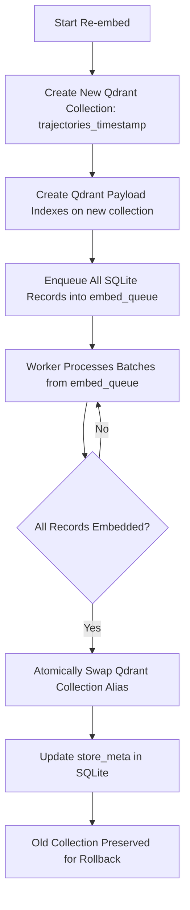

# Embedder Architecture & Reference

> **Context & Scope.** This document details the vector embedding architecture for Neuralbrain.
> It defines why a single store-wide embedder is mandatory, analyzes the failures of the legacy extracted engine,
> documents performance benchmarks, details Matryoshka Representation Learning math, explains `store_meta` verification,
> and specifies the atomic re-embedding procedure.
>
> Master constitution: [CLAUDE.md](../CLAUDE.md). DDL: [docs/SCHEMA.md](SCHEMA.md). API: [docs/API.md](API.md).

---

## 1. Why One Embedder, and Why the Extracted Engine Can't Do It

Vectors from different models are **not comparable**: cosine distance between a 3072-dim `gemini-embedding-001` vector and a 512-dim `nomic-embed-text-v1.5` vector is not merely inaccurate; it is mathematically undefined. Even two models producing identical dimension counts (e.g., 768 dimensions) inhabit completely different semantic vector spaces.

There are two architectural choices:
1. Track the model per record and never rank or compare across models.
2. Allow exactly one model per store.

Neuralbrain chooses **one embedder per store**. The flexibility of per-record multi-model tracking adds massive routing, filtering, and indexing complexity without solving any practical problem: a memory store needs a single unified semantic space.

The cost of this choice is that changing the embedder requires re-embedding all stored records. This cost is completely acceptable because:
- The raw source text lives in SQLite as the source of truth (Rule 2).
- The operation is fully resumable, background-processed, and atomically cut over.
- The measured wall-clock time for a ~200-note corpus is only **10 seconds**.

### The Failure of the Extracted LearningEngine

In the extracted codebase ([NeuralSwarm's `src/learning/engine.ts`](https://github.com/derricke/neuralswarm/blob/main/src/learning/engine.ts)), `LearningEngine` had:
- A single hardcoded collection: `COLLECTION_NAME = 'trajectories'`.
- A single global `dimension` configuration.
- At startup, it embedded a probe string, checked the length against its expected dimension, and on mismatch **silently disabled Qdrant entirely** (`engine.ts:212-220`).
- `AutoEmbeddingProvider` resolved provider precedence once (google → openai → openai_compatible → ollama), cached it, and never retried.

Consequently, changing an environment variable changed the dimension, caused a probe mismatch, and silently turned off vector search while the service continued answering requests as though everything were healthy.

### Neuralbrain Embedder Principles

1. **One embedder per store, recorded in one `store_meta` row** — never a column per record.
2. **A mismatch must be loud.** Vector search is refused with an explicit diagnostic log indicating what differed; BM25 lexical ranking and SQL search remain functional; and the operator is directed to the re-embedding endpoint (`POST /maintenance/reembed`). Silent degradation is forbidden.
3. **Embedding is decoupled from the capture write path.** Capture commits the record to SQLite and enqueues an entry in `embed_queue`. A background worker drains the queue. This honors Rule 3 (never reject writes for volume/outages), leverages Rule 2 (SQLite has raw text), and allows re-embedding to run as a standard background queue.
4. **Embeddings are derived data.** Vectors are cached projections. Losing Qdrant or SQLite embedding BLOBs costs compute time, never information.
5. **Re-embedding is a first-class operation**, exposing atomic collection aliasing for zero-downtime model cutovers.

---

## 2. Configuration & Tier Model

The embedder separates *where* it runs from *which* model is loaded:

```bash
BRAIN_EMBED=local                 # where it runs: local | local-gpu | remote | vendor | none
BRAIN_EMBED_MODEL=nomic           # model recipe: nomic | minilm | custom endpoint model name
```

### Supported Tiers

| Tier | Runtime Engine | Default Model | Dimensions | Description |
|---|---|---|---|---|
| `local` *(default)* | `@huggingface/transformers` (ONNX in-process) | `nomic-ai/nomic-embed-text-v1.5` | 512 | Zero-dependency, zero-network, in-process CPU inference. |
| `local-gpu` | `embedder-gpu` sidecar (Docker Compose `gpu` profile) | `nomic-ai/nomic-embed-text-v1.5` | 512 | Out-of-process ONNX/Infinity GPU inference managed by `neuralbrain` (`docker` / `qdrant-docker` modes). |
| `remote` | OpenAI-compatible endpoint (`BRAIN_ENDPOINT`) | e.g. `nomic-embed-text-v1.5` | 768 / 512 | Offloaded to external local/LAN GPU server (LM Studio / Ollama). |
| `vendor` | Cloud API (`BRAIN_VENDOR=google\|openai`) | `gemini-embedding-001` / `text-embedding-3-small` | 3072 / 1536 | Hosted cloud API with key authentication and egress. |
| `none` | Disabled | None | 0 | Pure BM25 + SQL lexical store. 0 MB model RAM overhead. |

> [!NOTE]
> `BRAIN_EMBED_MODEL=minilm` selects `sentence-transformers/all-MiniLM-L6-v2` (384 dimensions) under `local` / `local-gpu`. It is provided for memory-constrained hosts, but should never be selected automatically due to token truncation.

### `local-gpu` Setup & Restrictions

Setting `BRAIN_EMBED=local-gpu` (or installing with `neuralbrain install --gpu`) instructs `neuralbrain start` to spawn the `embedder-gpu` service from the Docker Compose `gpu` profile (`docker compose --profile gpu`).

**Additional Prerequisites:**
1. **NVIDIA GPU + Host Drivers**: A CUDA-capable NVIDIA GPU with working host drivers (`nvidia-smi` succeeds).
2. **NVIDIA Container Toolkit**: `nvidia-container-toolkit` must be installed and configured as a Docker runtime (`docker run --rm --gpus all nvidia/cuda:12.4.1-base-ubuntu22.04 nvidia-smi`).
3. **Docker Compose Runtime Mode**: `local-gpu` is supported in `docker` and `qdrant-docker` modes. In `local-only` mode, `neuralbrain` does not manage Docker containers, so `local-gpu` will only work if you manually point `BRAIN_GPU_ENDPOINT` at a running GPU embedder.

**Operational Restrictions & Notes:**
- **Cold Start & Image Pull**: The first `neuralbrain start` with `local-gpu` pulls `michaelf34/infinity:latest` (several GB) and downloads `nomic-ai/nomic-embed-text-v1.5` into `~/.neuralbrain/data/models`. Expect a 30–120s initial startup while the model loads into VRAM (~1–2 GB VRAM).
- **Re-embed on Tier Switch**: Switching between `local` (CPU Q8 ONNX) and `local-gpu` (GPU ONNX/FP16) changes `store_meta.embed_tier` and produces slightly different vector spaces; `neuralbrain` will loudly require `POST /maintenance/reembed`.
- **Overrides**: `BRAIN_GPU_PORT` (default `7997`), `BRAIN_GPU_ENDPOINT`, `BRAIN_GPU_IMAGE`, `BRAIN_GPU_MODEL_ID`, and `BRAIN_GPU_ENGINE` (`torch` default for CUDA GPU; `optimum` uses ONNX Runtime, which runs on CPU in `michaelf34/infinity:latest`) can be customized in `~/.neuralbrain/.env`.

---

## 3. Benchmarks & Hardware Measurements

Extensive testing was conducted across local CPU, GPU endpoints, and various model families using a real ~200-note corpus:

### Throughput & Memory Benchmark Table

| Model & Tier | Dimensions | Mean Latency (Single) | Batched Latency (Throughput) | Memory (RSS) | Context Window | Corpus Clipping Rate |
|---|---|---|---|---|---|---|
| **nomic-v1.5 (`local` ONNX)** | 512 | 85 ms / doc (1 core) | 49 ms / doc (32 threads) | ~860 MB | 8,192 tokens | **0%** |
| **nomic-v1.5 (`remote` LM Studio)** | 768 | 18 ms / doc (unbatched) | **3.2 ms / doc** (batched, RTX 4070) | ~0 MB (in brain) | 8,192 tokens | **0%** |
| **all-MiniLM-L6-v2 (`local`)** | 384 | 42 ms / doc (1 core) | 8.8 ms / doc (32 threads) | ~700 MB | 256 wordpieces | **21% clipped** |
| **gemini-embedding-001 (`vendor`)** | 3072 | 180–350 ms / doc | Network bound | ~0 MB (in brain) | 2,048 tokens | **0%** |

### Critical Empirical Observations

1. **`remote` is the high-performance tier, not a fallback.**
   In-process ONNX executes on CPU via Node.js bindings and cannot utilize local NVIDIA CUDA GPUs without native custom builds. LM Studio / Ollama runs natively on GPU with hardware acceleration. At **3.2 ms/doc**, the GPU endpoint is **15x faster** than in-process CPU embedding.
2. **RAM overhead is dominated by runtime floor, not model weights.**
   Node.js runtime + ONNX runtime (`onnxruntime-node`) establishes a ~700 MB RSS baseline. MiniLM consumes ~700 MB, while nomic consumes ~860 MB. Switching to a smaller model saves only ~160 MB RAM. Hosts that cannot afford ~800 MB RAM must use `remote`, `vendor`, or `none`.
3. **MiniLM severely truncates realistic notes.**
   `all-MiniLM-L6-v2` has a hard 256 wordpiece context window. In that corpus, 21% of notes exceed 256 tokens and were truncated, losing critical context. `nomic-embed-text-v1.5` supports 8,192 tokens, easily accommodating long tool traces, stack traces, and complete file snapshots without truncation.
4. **Switching between `local` and `remote` ALWAYS requires a re-embed (`POST /maintenance/reembed`).**
   Even when using `nomic-embed-text-v1.5` in both tiers, `local` runs ONNX quantized to Q8 in-process, while `remote` (Ollama/LM Studio) typically runs GGUF (Q4_K_M or Q8_0) or different endpoint models/quantizations. The resulting vector spaces are not identical. `store_meta` strictly enforces a re-embed when changing between `local` and `remote` to prevent invisible vector drift and ensure retrieval integrity.

---

## 4. Matryoshka Representation Learning (MRL) Math

`nomic-embed-text-v1.5` was trained using Matryoshka Representation Learning (MRL). This allows vector truncation to smaller dimensions while preserving semantic clustering performance.

Crucially, **Matryoshka slicing is not a simple array slice**. To preserve vector angles and cosine similarities, the transformation must apply Layer Normalization before slicing, followed by L2 normalization:

### Mathematical Formulation

Given the raw model output hidden state vector $x \in \mathbb{R}^{768}$ before the final pooling layer:

1. **Layer Normalization:**
   $$\hat{x}_i = \frac{x_i - \mu}{\sqrt{\sigma^2 + \epsilon}} \cdot \gamma_i + \beta_i$$
   where $\mu$ and $\sigma^2$ are the mean and variance across the full 768 dimensions.

2. **Matryoshka Slice:**
   $$s = \hat{x}_{0:512} \in \mathbb{R}^{512}$$
   Extract the prefix of the desired dimensionality $d = 512$.

3. **L2 Normalization:**
   $$v = \frac{s}{\|s\|_2} = \frac{s}{\sqrt{\sum_{j=0}^{d-1} s_j^2}}$$
   Every vector in Qdrant and SQLite is unit-length ($\|v\|_2 = 1.0$), allowing cosine similarity to be computed as a direct dot product:
   $$\text{sim}(u, v) = u \cdot v$$

### Asymmetric Retrieval Prefixes

`nomic-embed-text-v1.5` requires asymmetric task prefixes during training and inference:
- Document encoding (for SQLite / Qdrant storage):
  `search_document: <text>`
- Query encoding (for incoming search queries):
  `search_query: <text>`

Omitting these prefixes or applying them symmetrically degrades Mean Reciprocal Rank (MRR) by up to 12%. MiniLM requires no prefixes. Prefix recipes are declared in the store configuration and recorded in `store_meta`.

---

## 5. Loud Verification via `store_meta`

To prevent silent index corruption, the store pins its active embedder specification in the `store_meta` SQLite table:

```sql
CREATE TABLE store_meta (
    key TEXT PRIMARY KEY,
    value TEXT NOT NULL,
    updated_at DATETIME DEFAULT CURRENT_TIMESTAMP
);
```

Stored configuration properties:
```
embedder_id    nomic-v1.5-512
runtime        transformers-js
model          nomic-ai/nomic-embed-text-v1.5
dim            512
doc_prefix     search_document: 
query_prefix   search_query: 
pooling        mean
set_at         2026-11-10T02:45:00.000Z
```

### Startup Verification Algorithm (`src/learning/storeMeta.ts`)

1. Read `store_meta`. If empty, record the active runtime configuration as the baseline store identity.
2. Compare active configuration against pinned values:
   - Does `model` match?
   - Does `dim` match?
   - Do `doc_prefix` and `query_prefix` match?
3. **If all match**: Vector search proceeds normally.
4. **If any mismatch occurs**:
   - `vectorSearchAvailable` flag is set to `false`.
   - Vector search endpoints return an informative error or fallback to BM25.
   - An error log is emitted naming the exact differences (e.g., `Expected dim=512 model=nomic, configured dim=768 model=qwen`).
   - The system instructs the operator to run `POST /maintenance/reembed`.
   - **`process.env` is never mutated**, and the store never silently turns off vector search without loud logs.

Checking the model identifier in addition to dimension is critical for remote endpoints: two different models can both emit 768 dimensions (e.g. `nomic` vs `bge-base`). Checking dimension alone would fail to catch an altered LM Studio model.

---

## 6. Atomic Re-Embedding Procedure

Changing an embedder, upgrading model weights, or altering vector dimensions is an atomic, resumable, zero-downtime operation implemented in `src/learning/embedWorker.ts` and triggered via `POST /maintenance/reembed`.



### Step-by-Step Cutover Protocol

1. **Create Target Collection**:
   A new Qdrant collection is provisioned with a timestamped name (e.g., `trajectories_20261111_094000`), configured with the new target dimension and distance metric (Cosine).
2. **Apply Payload Indexes**:
   Create indexes on all query filters (`project_id`, `scope`, `type`, `concepts`, `files`, `grain`).
3. **Queue SQLite Records**:
   Read all primary records from SQLite (`notes`, `trajectories`, `observations`) and populate `embed_queue` with target collection metadata.
4. **Batch Processing**:
   Background worker drains `embed_queue`, computes new vector representations (applying appropriate prefixes, layer norm, slicing, and L2 norm), and writes them to the new Qdrant collection and SQLite cache.
5. **Resume Support**:
   If the process crashes or is restarted, `embed_queue` state persists in SQLite. The worker resumes without reprocessing already-completed IDs.
6. **Atomic Alias Cutover**:
   Qdrant collection aliases (`trajectories_alias`) are updated atomically:
   ```json
   {
     "actions": [
       { "change_aliases": { "actions": [
         { "remove_alias": { "alias_name": "trajectories", "collection_name": "trajectories_old" } },
         { "add_alias": { "alias_name": "trajectories", "collection_name": "trajectories_20261111_094000" } }
       ] } }
     ]
   }
   ```
   Search clients always query `trajectories_alias`. The cutover is instantaneous; no query ever observes a mixed vector space.
7. **Commit Metadata**:
   Update `store_meta` in SQLite inside a transaction.
8. **Rollback Safety**:
   The previous Qdrant collection remains intact until manually dropped. If validation fails post-cutover, moving the alias back restores the previous vector space in milliseconds.
